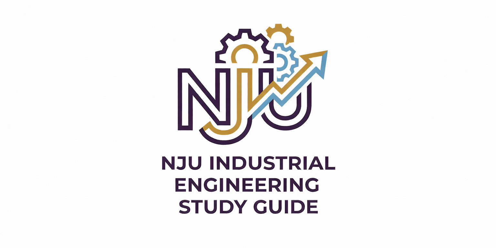

<figure markdown>
  { width="800" }
</figure>

# 前言
本网站灵感来源于[CS自学指南](https://csdiy.wiki/)，目的是为南京大学工业工程系的学子提供全方位的学习支持，其中大一的基础课内容也适合绝大多数理工科。

本网站内容包括：

- 南京大学的工业工程（IE）在干什么。

- 学习 IE 要用到的基本工具：如git、latex、gurobi等等。

- **南大IE所有课程资料汇总**：把NJUIE所有课程资源分门别类进行汇总，包含学习内容、任课老师、课程教材、课程学习建议
、往年卷、补充资料等，供大家学习参考。

- 一些竞赛的信息。

- 升学（考研、保研、留学）、实习的信息。

- 经典书籍推荐：推荐IE领域的必看好书。

  
✍️ 发现错误 / 想补充资料？

  
在站内表单里选类型、填内容，点一下就会打开预填好的 GitHub Issue 页面，把文件拖进去、点提交即可。24 小时内机器人会给出变更预览，维护者批准后自动上线。

  
<a class="ie-home-entry-btn" href="提交修改/">去提交修改 →</a>也可以看看<a href="贡献指南/contribution_tutorial.md">贡献指南</a>（邮箱 / Issue / PR 方式）

## 为什么建立这个网站

这本书的目的就是要建立南大IE**自己的学习指南**。每个人都可以把自己的学习资源与方法分享，再由专人分门别类详细汇总，让知识与经验平等且高效地惠及每一个人。

【注】本网站内容借鉴了[浙大图灵班学习指南](https://zju-turing.github.io/TuringCourses/readings/)。

